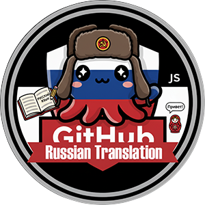

<div align="center">
  
</div>
<h1 align="center"> GitHub Russian Translation </h1>
<div align="center">


</div>


## 🎯 Описание: ##
Пользовательский скрипт для автоматического перевода интерфейса GitHub на русский язык.

## 📝 Как установить и использовать: ##
**1. Установите Tampermonkey (если ещё не установлен):**
- [Chrome/Edge](https://chromewebstore.google.com/detail/tampermonkey/dhdgffkkebhmkfjojejmpbldmpobfkfo)
- [Firefox](https://addons.mozilla.org/en-US/firefox/addon/tampermonkey/)
- [Safari](https://apps.apple.com/us/app/tampermonkey/id1482490089)

**2. Скачайте скрипт:** 
- [GitHubRussianTranslation](https://raw.githubusercontent.com/smi-falcon/GitHub-Russian-Translation/refs/heads/dictionary-update/Userscript/GitHub%20Russian%20Translation.js)
- [GitHubTimeTranslation](https://raw.githubusercontent.com/smi-falcon/GitHub-Russian-Translation/refs/heads/dictionary-update/Userscript/GitHub%20Time%20Translation.js)
  
**3. Установите скрипт:**
- Откройте Tampermonkey (нажав на иконку в браузере).
- Нажмите на "Панель управления".
- Перенесите скачанный скрипт в открытую вкладку.

**4. Включите режим разработчика:**
- Откройте расширения браузера (chrome://extensions или edge://extensions).
- Включите переключатель "Режим разработчика" в правом верхнем углу.

**5. Использование:**
- Скрипт автоматически активируется на всех страницах GitHub.
- Перевод применяется к основным элементам интерфейса.
- Работает с динамически загружаемым контентом.

## 🛠️ Настройка: ##
1. Откройте скрипт GitHub-Russian-Translation.js и найдите объект ```exactTranslations```. 
2. Добавьте пару *"английский текст": "русский перевод"*, внутрь объекта, соблюдая точное написание исходной фразы.
3. Перед добавлением проверьте, нет ли этой фразы уже в словаре, чтобы не создавать дубликат.
4. Для фраз с числами используйте ```pluralTranslations```, а не точные ключи.
5. Перезагрузите страницу GitHub. Для проверки в консоли браузера выводится число загруженных фраз.

## 📚 Особенности скрипта: ##
- **Обширный словарь:** Переводит более 12000+ основных терминов и элементов интерфейса GitHub.
- **Обработка временных меток:** Перевод относительного времени real-time, relative-time.
- **Обработка многострочных текстов:** Переводит длинные описания, подсказки и системные уведомления.
- **Обработка числовых паттернов:** Переводит фразы с числами и локализует их названия.
- **Умное склонение чисел:** Автоматически переводит числовые паттерны с правильными окончаниями.
- **Умная замена:** Переводит текст в элементах, атрибутах placeholder, aria-label, title, alt, value, label, data-tooltip-content, data-hovercard-text, data-message и data-content.
- **Динамический перевод:** Использует MutationObserver для перевода контента, загружаемого через AJAX.
- **Локализация SVG-графиков:** Переводит текст и подписи в динамических графиках.
- **Поддержка React-компонентов:** Переводит элементы Overlay, диалоговых окон и выпадающих списков.
- **Защита от повторного перевода:** Проверяет наличие кириллицы перед заменой текста.
- **Интеллектуальное исключение областей:** Игнорирует перевод кода, Readme, дерева файлов, diff-вьюверов, имена веток, редакторы (CodeMirror, Monaco), коммиты, SVG, поля с contenteditable и элементы с translate="no".
- **Отслеживание изменений:** MutationObserver переводит новый контент, загруженный через AJAX и React. Обработка сгруппирована через requestAnimationFrame, чтобы не нагружать страницу.
- **Поддержка Turbo/PJAX:** Отслеживает SPA-навигацию GitHub и переводит контент при смене страниц без перезагрузки.
- **Производительность:** Оптимизирован для минимального влияния на скорость работы сайта.

## 📚 Что переводится: ##
- Основная навигация.
- Элементы репозитория.
- Кнопки действий.
- Страницы профиля и настроек.
- Временные метки.
- Формы и поля ввода.
- Диалоговые окна.
- Статистика и графики.

## 🦉 Git Help: ##
Помимо перевода, скрипт добавляет подсказки для новичков в Git и GitHub:
- **Глоссарий Git-терминов:** 97 терминов с понятными объяснениями (commit, branch, fork, rebase и др.).
- **Пояснения к фильтрам:** объяснение фильтров на страницах Issues и Pull requests.
- **Информационные значки:** подсказки у кнопок и фильтров интерфейса.
- **Контекстные подсказки:** баннеры на отдельных страницах GitHub (показываются один раз).
- **Онбординг:** приветственный баннер для новых пользователей (показывается один раз).
- **Кнопка ❔ (справка):** модальное окно с глоссарием и настройками.
- **Кнопка 🇷🇺 / 🇬🇧:** переключение между русским интерфейсом и оригиналом (English) без перезагрузки страницы.
- **Перевод Markdown:** по умолчанию выключен, чтобы не портить форматирование Readme и других Markdown-файлов. Включается в окне справки.

## 🤝 Вклад в проект: ##
Предложения по переводу, сообщения об ошибках и pull request'ы приветствуются.

## ⭐ Поддержка проекта: ##
Если вам понравился данный проект, поставьте ему звезду на GitHub.

## 📄 Лицензия: ##
- [MIT License](https://github.com/smi-falcon/GitHub-Russian-Translation/blob/dictionary-update/License.md)